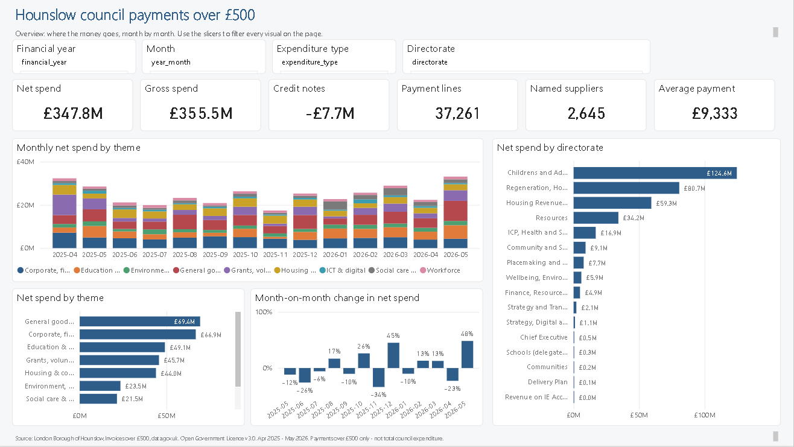
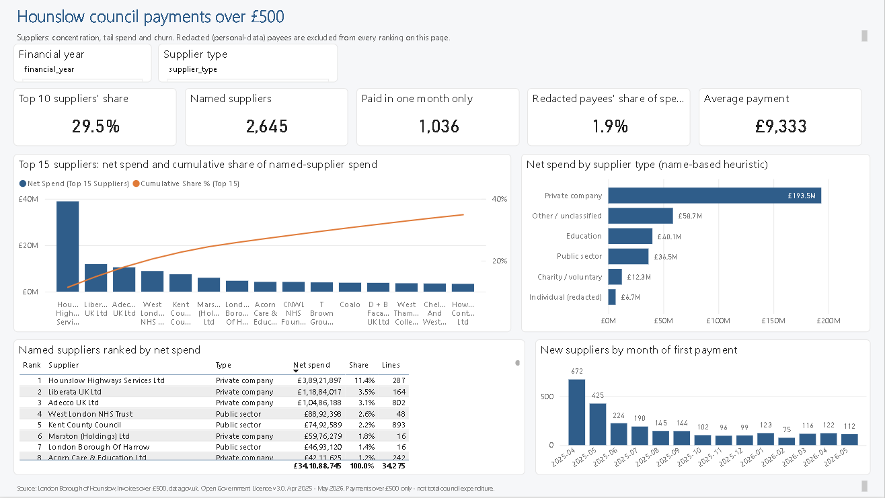
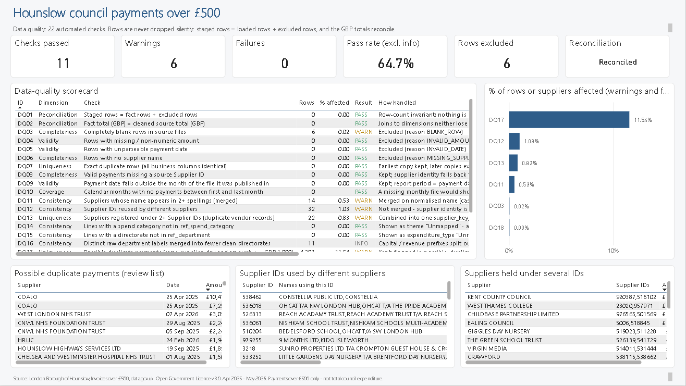

# Council Spending Analytics: SQL + Python + Power BI

Author: Anurag Moyal

An end-to-end analytics project on **local-government "payments over £500" open data**: 14 monthly files (Apr 2025 - May 2026, CSV and Excel) are combined into one cleaned SQL star schema, quality-checked, optionally categorised with a text-classification model, and prepared for a Power BI dashboard on spend by supplier, category and month, with KPIs and data-quality checks.

| | |
|---|---|
| **Data** | London Borough of Hounslow, *Invoices over £500* - [data.gov.uk](https://www.data.gov.uk/dataset/f713ba22-28ee-4be6-8a9a-3b15042a1f69/council-spending-over-f5001), **Open Government Licence v3.0** |
| **Volume** | 37,267 published lines, **£347.8m** net spend, 2,645 named suppliers |
| **Stack** | SQL (SQLite, portable to SQL Server/Postgres), Python (pandas, scikit-learn, rapidfuzz), Power BI (Power Query M + DAX) |
| **Tests** | 15 automated tests on the SQL logic (`pytest`) |



## What this project shows
* **Data engineering in SQL** - staging, typed cleaning, window functions, recursive-CTE date dimension, star schema, audit trail of excluded rows.
* **Real data-quality work, not a tidy dataset** - mixed CSV/Excel formats and date formats, blank rows, supplier-name variants, ~500 redacted payees that must *not* be merged, reused and duplicated supplier IDs, renamed directorates, typos in labels.
* **Reconciliation you can prove** - `staged rows = loaded + excluded` and `loaded £ = cleaned source £` are asserted on every run (checks DQ01 / DQ02).
* **Analyst judgement made explicit** - every mapping (themes, directorates) lives in a SQL table; every assumption is documented in [docs/methodology.md](docs/methodology.md).
* **ML add-on with grouped cross-validation** - supplier-grouped CV (so the score is not inflated by memorised supplier names), used to build a *coding-review queue* instead of claiming a perfect classifier.
* **BI delivery** - a ready-to-open Power BI Project ([`powerbi/council-spending.pbip`](powerbi)): star-schema model, 36 DAX measures, 5 report pages / 67 visuals and a theme. It was opened and refreshed in Power BI Desktop and reconciled to the SQL results (£347.8m, 37,261 lines, 2,645 suppliers). Power Query (M), DAX and a manual build guide are also provided.

## Key results (all computed by `src/findings.py`; full detail in [docs/findings.md](docs/findings.md))
* Net spend **£347.8m** over 14 months (gross £355.5m less £7.7m credit notes); monthly range £17.4m (Nov 2025) to £33.1m (May 2026).
* **Concentration:** the top 10 named suppliers take 29.5% of named-supplier spend; 42 suppliers make up half of it, and 236 make up 80% - a long tail. Hounslow Highways Services alone is 11.4%.
* **Tail spend:** 39% of named suppliers were paid in only one month of the period (≈ 2.9% of spend).
* **Data quality:** 22 checks - 11 pass, 6 warnings, 0 integrity failures. Notable warnings: 22 suppliers held under more than one Supplier ID, 32 Supplier IDs shared by different suppliers, 14 suppliers spelled several ways, 4,301 lines flagged as *possible* duplicate payments (same supplier, day and amount - a review list, many are genuine batch payments).
* **Redacted payees:** 2,986 lines / £6.7m go to payees whose names are withheld; they are kept in totals but excluded from supplier rankings.
* **Classification:** a supplier-grouped model recovers the council's own spend *theme* for ~61% of lines on unseen suppliers (majority baseline 13%) and flags ~1,600 lines worth ~£21.7m for coding review - for example the council's data codes the very large Hounslow Highways Services payments as "Financial services", which is the kind of thing an analyst would ask the council about.





## Quick start
Requires Python 3.10+.

```bash
pip install -r requirements.txt
python run_pipeline.py --download     # downloads the 14 monthly files, builds everything
python -m pytest -q                   # SQL unit tests (no download needed)
```

`run_pipeline.py` runs: download -> stage -> SQL (clean, model, DQ) -> fuzzy supplier matches -> classifier -> CSV export -> findings and charts. Outputs land in `data/processed/` (already committed, so you can open Power BI straight away) and `docs/`.

Then open **`powerbi/council-spending.pbip`** in Power BI Desktop. If it shows no data, set *Home > Transform data > Edit parameters > DataFolder* to the full path of `data\processed\` (with a trailing backslash) and click Refresh; then File > Save as `.pbix` for a single portable file. Steps and page descriptions: [powerbi/00_START_HERE.md](powerbi/00_START_HERE.md).

## Repository layout
```
config/source_map.json        publisher column names -> pipeline names (change this to reuse for another council)
src/                          download.py, ingest.py, run_sql.py, supplier_matching.py, classify.py, export.py, findings.py
sql/                          01_clean_staging, 02_reference_data, 03_model, 04_data_quality, 05_analysis_queries
data/processed/               star-schema CSVs for Power BI + data-quality and ML outputs
powerbi/                      council-spending.pbip (open this), build_project.py, Power Query (M), DAX, theme, guides
docs/                         methodology, data dictionary, findings, classification report, charts, porting notes
tests/                        pytest suite for the SQL pipeline
run_pipeline.py               one-command end-to-end run
```

## Data licence and attribution
Contains public sector information licensed under the [Open Government Licence v3.0](https://www.nationalarchives.gov.uk/doc/open-government-licence/version/3/). Source: London Borough of Hounslow, *Council spending over £500*, via data.gov.uk. The raw files are not committed; `src/download.py` fetches them. Payee names marked *REDACTED PERSONAL DATA* are redacted at source and are deliberately never re-identified. Code in this repository is MIT licensed.

## Limitations
* Covers payments over £500 only (no payroll or smaller invoices), so totals are not the council's total expenditure.
* Supplier identity is name-based and `spend_theme` / `supplier_type` are analyst-defined groupings - both are documented, editable and should be agreed with a domain owner.
* Built and run on Hounslow data; adapting it to a different council (for example a Scottish council) is covered in [docs/adapting_to_another_council.md](docs/adapting_to_another_council.md).
* The Power BI Project (`.pbip`, plain-text files) is included; a binary `.pbix` is not committed - create it with File > Save as after opening the project.
