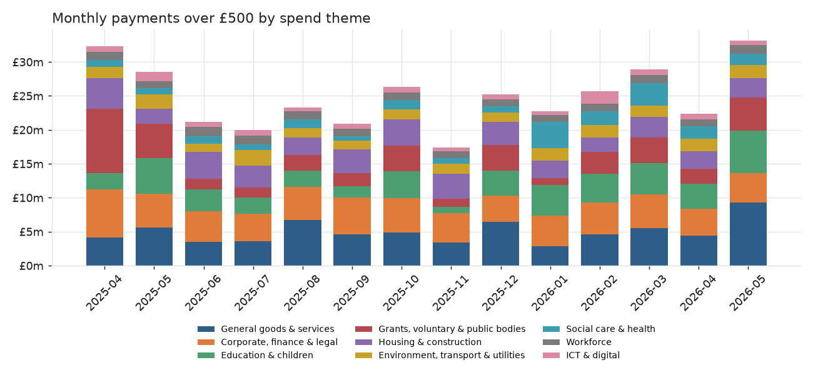
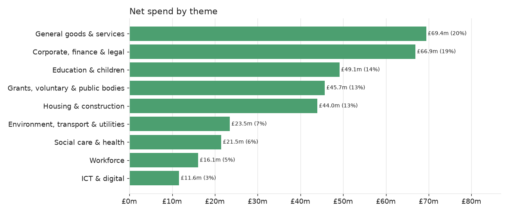
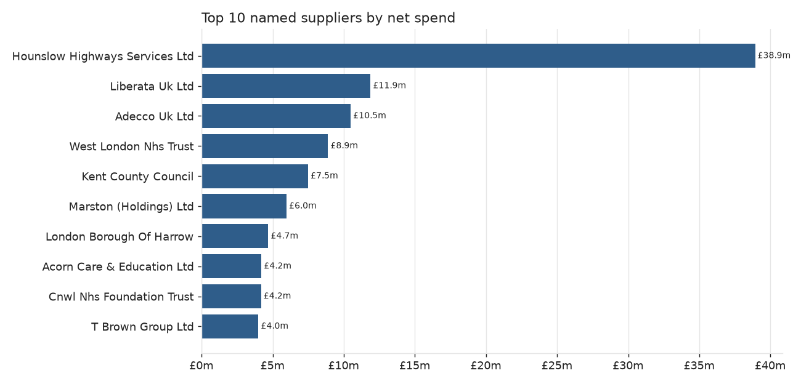
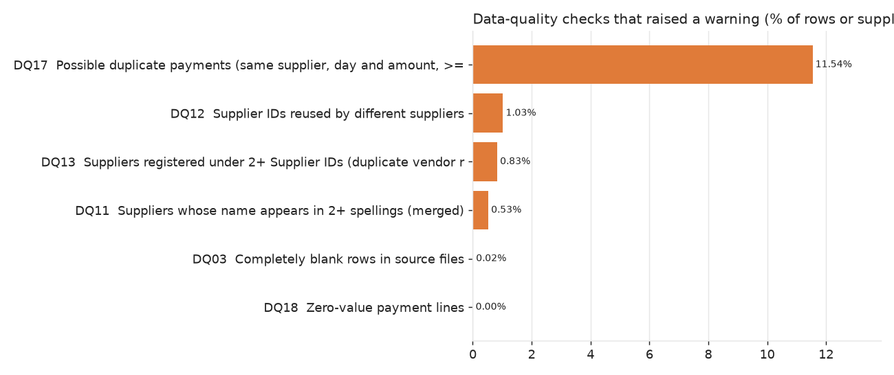

# Findings (auto-generated by `src/findings.py`)

Period: **2025-04-01 to 2026-05-29** | Source: London Borough of Hounslow, *Invoices over £500* (Open Government Licence v3.0).

## Headline numbers
| KPI | Value |
|---|---:|
| Net spend (after credit notes) | £347,756,717 |
| Gross spend (positive payments) | £355,499,794 |
| Credit notes / refunds | -£7,743,078 |
| Payment lines | 37,261 |
| Distinct named suppliers | 2,645 |
| Average payment line | £9,333 |

Highest month: **2026-05** (£33,111,927); lowest: **2025-11** (£17,421,537).

## Spend by theme

## Supplier concentration
* Top 10 named suppliers receive **29.5%** of named-supplier spend.
* **42** suppliers account for 50% of spend and **236** for 80% (out of 2,643 with positive spend) - a long tail.
* Herfindahl-Hirschman index: **194** (below 1,500 = unconcentrated).
* **39%** of named suppliers were paid in only one month of the period, together worth £9,989,896 (2.9% of spend) - a tail-spend / procurement-consolidation question.

### Top 15 suppliers
| rank | supplier_name | supplier_type | net_spend | lines | share_pct | cumulative_share_pct |
|---:|---|---|---:|---:|---:|---:|
| 1 | HOUNSLOW HIGHWAYS SERVICES LTD | Private company | 38,921,897 | 287 | 11.41 | 11.41 |
| 2 | LIBERATA UK LTD | Private company | 11,884,017 | 164 | 3.48 | 14.90 |
| 3 | ADECCO UK LTD | Private company | 10,486,188 | 802 | 3.07 | 17.97 |
| 4 | WEST LONDON NHS TRUST | Public sector | 8,892,398 | 48 | 2.61 | 20.58 |
| 5 | KENT COUNTY COUNCIL | Public sector | 7,492,589 | 893 | 2.20 | 22.77 |
| 6 | MARSTON (HOLDINGS) LTD | Private company | 5,976,279 | 16 | 1.75 | 24.53 |
| 7 | LONDON BOROUGH OF HARROW | Public sector | 4,693,120 | 16 | 1.38 | 25.90 |
| 8 | ACORN CARE & EDUCATION LTD | Private company | 4,211,625 | 242 | 1.23 | 27.14 |
| 9 | CNWL NHS FOUNDATION TRUST | Public sector | 4,186,643 | 49 | 1.23 | 28.36 |
| 10 | T BROWN GROUP LTD | Private company | 3,998,615 | 101 | 1.17 | 29.54 |
| 11 | COALO | Other / unclassified | 3,844,720 | 9 | 1.13 | 30.66 |
| 12 | D + B FACADES UK LTD | Private company | 3,798,178 | 6 | 1.11 | 31.78 |
| 13 | WEST THAMES COLLEGE | Education | 3,615,093 | 68 | 1.06 | 32.84 |
| 14 | CHELSEA AND WESTMINSTER HOSPITAL NHS TRUST | Public sector | 3,508,556 | 138 | 1.03 | 33.87 |
| 15 | HOWARTH CONTRACTORS LTD | Private company | 3,367,727 | 14 | 0.99 | 34.85 |

### Spend by supplier type (name-based heuristic)
| supplier_type | suppliers | net_spend | share_pct |
|---|---:|---:|---:|
| Private company | 1,400 | 193,458,364 | 55.6 |
| Other / unclassified | 751 | 58,712,219 | 16.9 |
| Education | 281 | 40,072,962 | 11.5 |
| Public sector | 69 | 36,526,151 | 10.5 |
| Charity / voluntary | 144 | 12,319,050 | 3.5 |
| Individual (redacted) | 503 | 6,667,971 | 1.9 |

## Spend by directorate
| directorate | expenditure_type | net_spend | lines |
|---|---|---:|---:|
| Childrens and Adult Services | Revenue | 124,515,380 | 15,776 |
| Regeneration, Housing and Environmental Services | Revenue | 64,307,366 | 7,216 |
| Housing Revenue Account | HRA Capital | 35,782,831 | 1,168 |
| Resources | Revenue | 32,222,504 | 2,556 |
| Housing Revenue Account | HRA | 23,547,367 | 4,253 |
| ICP, Health and Social Care Integration | Revenue | 16,890,491 | 730 |
| Regeneration, Housing and Environmental Services | Capital | 16,359,472 | 964 |
| Community and Strategy | Revenue | 8,739,615 | 1,854 |
| Placemaking and Growth | Revenue | 6,768,252 | 1,226 |
| Wellbeing, Environment and Commissioning | Revenue | 5,799,455 | 323 |
| Finance, Resources and Assets | Revenue | 4,124,279 | 180 |
| Strategy and Transformation | Revenue | 2,117,734 | 291 |

## Month-on-month
| year_month | net_spend | lines | mom_change | mom_change_pct | rolling_3m_avg |
|---|---:|---:|---:|---:|---:|
| 2025-04 | 32,314,924 | 2,657 |  |  | 32,314,924 |
| 2025-05 | 28,529,104 | 3,264 | -3,785,820 | -11.7 | 30,422,014 |
| 2025-06 | 21,157,265 | 2,155 | -7,371,839 | -25.8 | 27,333,764 |
| 2025-07 | 19,929,620 | 2,454 | -1,227,645 | -5.8 | 23,205,330 |
| 2025-08 | 23,256,682 | 2,372 | 3,327,062 | 16.7 | 21,447,856 |
| 2025-09 | 20,859,077 | 2,505 | -2,397,605 | -10.3 | 21,348,460 |
| 2025-10 | 26,310,010 | 2,804 | 5,450,933 | 26.1 | 23,475,256 |
| 2025-11 | 17,421,537 | 2,114 | -8,888,473 | -33.8 | 21,530,208 |
| 2025-12 | 25,266,370 | 2,596 | 7,844,832 | 45.0 | 22,999,306 |
| 2026-01 | 22,698,953 | 2,725 | -2,567,416 | -10.2 | 21,795,620 |
| 2026-02 | 25,656,902 | 2,705 | 2,957,949 | 13.0 | 24,540,742 |
| 2026-03 | 28,911,666 | 2,932 | 3,254,763 | 12.7 | 25,755,840 |
| 2026-04 | 22,332,679 | 2,875 | -6,578,986 | -22.8 | 25,633,749 |
| 2026-05 | 33,111,927 | 3,103 | 10,779,248 | 48.3 | 28,118,757 |

## Ten largest single payments
| payment_date | supplier_name | spend_category | directorate | amount |
|---|---|---|---|---:|
| 2026-01-09 | WEST LONDON NHS TRUST | Social, community care & healthcare | ICP, Health and Social Care Integration | 2,598,901 |
| 2025-04-16 | BEVAN BRITTAN | Legal (excl. counsel fees) | Housing Revenue Account | 2,500,000 |
| 2025-05-23 | AVISON YOUNG TRADING AS GVA GRIMLEY LTD | Professional services (consultants) | Regeneration, Housing and Environmental Services | 2,328,080 |
| 2026-05-26 | HOUNSLOW HIGHWAYS SERVICES LTD | Financial services | Wellbeing, Environment and Commissioning | 2,224,587 |
| 2025-05-23 | HOUNSLOW HIGHWAYS SERVICES LTD | Financial services | Regeneration, Housing and Environmental Services | 2,199,319 |
| 2025-07-22 | HOUNSLOW HIGHWAYS SERVICES LTD | Financial services | Regeneration, Housing and Environmental Services | 2,193,021 |
| 2025-06-24 | HOUNSLOW HIGHWAYS SERVICES LTD | Financial services | Regeneration, Housing and Environmental Services | 2,192,671 |
| 2026-04-28 | HOUNSLOW HIGHWAYS SERVICES LTD | Financial services | Placemaking and Growth | 2,191,085 |
| 2026-01-27 | HOUNSLOW HIGHWAYS SERVICES LTD | Financial services | Regeneration, Housing and Environmental Services | 2,190,019 |
| 2025-09-26 | HOUNSLOW HIGHWAYS SERVICES LTD | Financial services | Regeneration, Housing and Environmental Services | 2,187,231 |

## Statistical outliers (z-score > 4 within spend category)
| supplier_name | spend_category | payment_date | amount | z_score |
|---|---|---|---:|---:|
| AVISON YOUNG TRADING AS GVA GRIMLEY LTD | Professional services (consultants) | 2025-05-23 | 2,328,080 | 49.9 |
| EVOUCHERS LTD | Education & sports | 2026-04-02 | 988,000 | 34.1 |
| BYTES SOFTWARE SERVICES | ICT hardware, software & networks | 2026-02-13 | 1,116,501 | 29.2 |
| WEST THAMES COLLEGE | General goods & services | 2026-05-26 | 1,441,388 | 27.1 |
| SHOOSMITHS LLP CLIENT ACCOUNT | Accommodation (housing) | 2025-04-16 | 445,000 | 25.0 |
| WEST LONDON NHS TRUST | Social, community care & healthcare | 2026-01-09 | 2,598,901 | 24.9 |
| HOWARTH CONTRACTORS LTD | Accommodation (housing) | 2026-03-17 | 434,172 | 24.4 |
| GREAT OAK COLLEGE | Education & sports | 2026-05-22 | 695,625 | 23.9 |
| SMART PLAY PVT LTD | Grants & allowances | 2025-04-04 | 405,600 | 23.6 |
| HOWARTH CONTRACTORS LTD | Accommodation (housing) | 2025-12-12 | 416,658 | 23.4 |

## Data quality
11 checks passed, 6 raised warnings, 0 failed, 5 are profile items.
Payments to redacted (personal-data) payees: **2,986 lines / £6,667,971** - they cannot be analysed by supplier and are excluded from rankings.

| check_id | dimension | check_name | rows_affected | pct_affected | result |
|---|---|---|---:|---:|---|
| DQ01 | Reconciliation | Staged rows = fact rows + excluded rows | 0 | 0.00 | PASS |
| DQ02 | Reconciliation | Fact total (GBP) = cleaned source total (GBP) | 0 |  | PASS |
| DQ03 | Completeness | Completely blank rows in source files | 6 | 0.02 | WARN |
| DQ04 | Validity | Rows with missing / non-numeric amount | 0 | 0.00 | PASS |
| DQ05 | Validity | Rows with unparseable payment date | 0 | 0.00 | PASS |
| DQ06 | Completeness | Rows with no supplier name | 0 | 0.00 | PASS |
| DQ07 | Uniqueness | Exact duplicate rows (all business columns identical) | 0 | 0.00 | PASS |
| DQ08 | Completeness | Valid payments missing a source Supplier ID | 0 | 0.00 | PASS |
| DQ09 | Validity | Payment date falls outside the month of the file it was published in | 0 | 0.00 | PASS |
| DQ10 | Coverage | Calendar months with no payments between first and last month | 0 |  | PASS |
| DQ11 | Consistency | Suppliers whose name appears in 2+ spellings (merged) | 14 | 0.53 | WARN |
| DQ12 | Consistency | Supplier IDs reused by different suppliers | 32 | 1.03 | WARN |
| DQ13 | Uniqueness | Suppliers registered under 2+ Supplier IDs (duplicate vendor records) | 22 | 0.83 | WARN |
| DQ14 | Consistency | Lines with a spend category not in ref_spend_category | 0 | 0.00 | PASS |
| DQ15 | Consistency | Lines with a directorate not in ref_department | 0 | 0.00 | PASS |
| DQ16 | Consistency | Distinct raw department labels merged into fewer clean directorates | 11 |  | INFO |
| DQ17 | Uniqueness | Possible duplicate payments (same supplier, day and amount, >= GBP 1,000) | 4,301 | 11.54 | WARN |
| DQ18 | Validity | Zero-value payment lines | 1 | 0.00 | WARN |
| DQ19 | Profile | Credit notes / refunds (negative amounts) | 467 | 1.25 | INFO |
| DQ20 | Profile | Lines under GBP 500 (threshold applies to the invoice, not each line) | 1,678 | 4.50 | INFO |
| DQ21 | Profile | Payments to redacted (personal-data) payees | 2,986 | 8.01 | INFO |
| DQ22 | Profile | Suppliers the sector heuristic could not classify | 751 | 23.86 | INFO |

## Optional extra: text classification
A supplier-grouped cross-validated classifier recovers the council's spend category for **57%** of lines and its spend *theme* for **61%** (majority-class baseline is far lower). It flags **1,587** lines for coding review. Details: [classification_report.md](classification_report.md).
